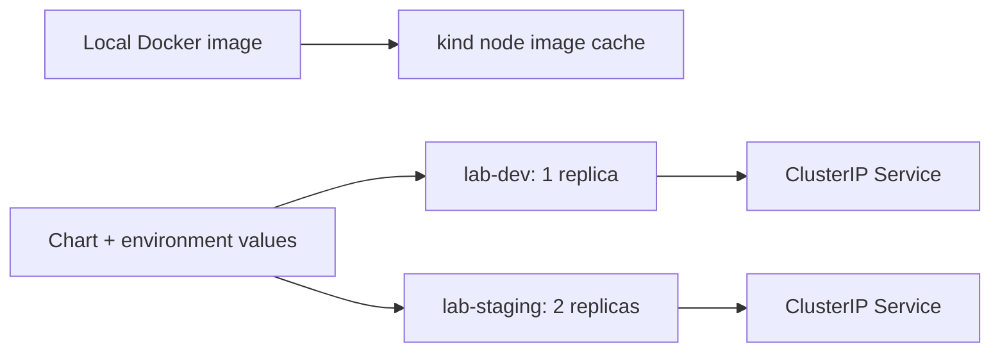

# Local Kubernetes and Helm lab

## What this adds

The same runtime image now runs on a one-node kind cluster through a Helm chart. Two releases named `delivery-lab` live in separate namespaces: `lab-dev` and `lab-staging`. Each release owns a Deployment and a ClusterIP Service.



The cluster runs entirely inside the existing Docker Linux engine. It has its own kubeconfig at `work/kubeconfig`; the setup does not change the user's default kubeconfig. The Kubernetes API binds to loopback. No image registry or cloud account is needed.

## Reproduce from PowerShell 7

Run these commands from the repository root with Docker's Linux engine running. The bootstrap supports Windows x64 and Linux x64. It downloads kind v0.33.0, Helm v4.3.1, and kubectl v1.36.4 into the ignored `work/tools` directory, checks their pinned SHA-256 values, and leaves system PATH unchanged. On Windows, append `.exe` to explicit tool paths if the shell does not resolve executable extensions.

```powershell
./scripts/install-local-tools.ps1
./scripts/verify-chart.ps1
docker build --target runtime -t platform-delivery-lab:0.1.0 .
./scripts/create-local-cluster.ps1
./work/tools/kind load docker-image platform-delivery-lab:0.1.0 --name platform-delivery-lab
./scripts/verify-kubernetes.ps1
```

Check each command's result before continuing. Cluster creation refuses to replace an existing cluster of the same name. For an existing lab, skip creation and reuse its `work/kubeconfig`. The verification script may be rerun; it reconciles both releases to the supplied image tag and application version, with readiness enabled.

The node image is Kubernetes v1.36.4 and is pinned by digest in `kind/cluster.yaml`. Tool versions and checksums are recorded in `scripts/local-tools.json`. Checksums protect against changed downloads; this bootstrap does not perform signature verification.

## Understand the chart

| Component | Purpose |
| --- | --- |
| `Chart.yaml` | Chart version 0.1.0 and application version metadata. |
| `values.yaml` | Common image, application, replica, and resource settings. |
| `values-dev.yaml` | One replica, environment `dev`, smaller resource requests. |
| `values-staging.yaml` | Two replicas, environment `staging`, larger resource requests and limits. |
| `values.schema.json` | Rejects unknown settings, invalid replica counts, empty image tags, and non-boolean readiness settings. |
| Deployment | Runs Gunicorn, manages replicas and rolling updates, configures probes and runtime constraints. |
| ClusterIP Service | Gives ready application pods a stable DNS name and internal endpoint. |

Development requests 100m CPU and 64Mi memory per pod, with 500m/128Mi limits. Staging requests 200m/96Mi per pod, with 1 CPU/192Mi limits. These are learning defaults, not capacity measurements. Two staging replicas demonstrate replica and rollout behavior; both share one node and do not provide node-level high availability. Namespaces separate names and releases but do not enforce network isolation.

Startup and liveness probes use `/healthz`. Readiness uses `/readyz`. This distinction allows a healthy process to be deliberately unready without requesting a restart. The application's readiness flag is read at startup; changing it through Helm creates replacement pods. The controlled failed-rollout and recovery exercise is a later milestone.

Rolling updates allow one extra pod and keep all desired replicas available while replacement pods become ready (`maxSurge: 1`, `maxUnavailable: 0`). This requires spare capacity; the lab has not established production availability guarantees.

The pod runs as UID/GID 10001, drops Linux capabilities, disables privilege escalation, uses RuntimeDefault seccomp, and has a read-only root filesystem. A 32Mi memory-backed `emptyDir` supplies writable `/tmp` for Gunicorn; its contents disappear with the pod. Service-account token mounting is disabled. The setup creates namespaces enforcing the Kubernetes `restricted` Pod Security policy at version v1.36.

The image tag and reported application version are separate settings. The local verifier sets `image.pullPolicy=Never` so a missing imported image fails instead of falling back to a registry. CI sets tag `ci` and reports `ci-<checkout SHA>` (the merge commit for a pull-request run); `/version` is deployment-supplied metadata, not an independent build attestation.

## Inspect the running lab

```powershell
./work/tools/kubectl --kubeconfig work/kubeconfig --context kind-platform-delivery-lab get pods -A
./work/tools/helm --kubeconfig work/kubeconfig --kube-context kind-platform-delivery-lab list -A
./work/tools/kubectl --kubeconfig work/kubeconfig --context kind-platform-delivery-lab -n lab-staging get deployment,service,endpointslices
./work/tools/kubectl --kubeconfig work/kubeconfig --context kind-platform-delivery-lab -n lab-staging logs -l app.kubernetes.io/instance=delivery-lab --all-containers=true
```

For browser access, keep this command running in one terminal:

```powershell
./work/tools/kubectl --kubeconfig work/kubeconfig --context kind-platform-delivery-lab -n lab-staging port-forward --address 127.0.0.1 service/delivery-lab 8081:8080
```

Open `http://127.0.0.1:8081/version`. Expect environment `staging` and version `0.1.0` for the default local verification. Ctrl+C stops only the forwarding process. Port-forwarding is useful for inspection; the automated verifier separately exercises Service DNS and ClusterIP routing from inside a pod.

To remove only this lab cluster when finished:

```powershell
./work/tools/kind delete cluster --name platform-delivery-lab
```

This removes both lab namespaces and their releases with the cluster. Cached Docker images and `work/kubeconfig` remain local; running the creation script again writes a new lab kubeconfig. The original standalone container on port 8080 is independent.

## Verification and limits

`verify-chart.ps1` lints and renders both environments, then confirms three invalid settings fail schema validation. `verify-kubernetes.ps1` installs both releases with Helm waiting for readiness, verifies rollout completion and replica counts, checks ready Service endpoints and pod security settings, and rejects runtime error logs. It executes real JSON requests to all four endpoints through Service DNS and checks UID/GID, filesystem behavior, writable `/tmp`, and absent API credentials at runtime. Failure paths print pods, deployment details, events, and logs. The releases remain available locally for inspection.

The [CI workflow](ci.md) repeats these checks in a disposable kind cluster and removes that cluster in an `always()` step. It does not use credentials for a persistent cluster. The namespace setup is outside the chart so uninstalling one Helm release does not delete a namespace.

No ingress, TLS, NetworkPolicy, image publishing, vulnerability scanning, load testing, or GitOps controller is included in this milestone. Resource sizing and application version metadata require separate validation for production use.

See [the verification record](verification/2026-10-22-kubernetes.md) for observed results.

## Primary references

- [kind v0.33.0 release and node digests](https://github.com/kubernetes-sigs/kind/releases/tag/v0.33.0)
- [kind quick start and local image loading](https://kind.sigs.k8s.io/docs/user/quick-start/)
- [Helm v4.3.1 release and downloads](https://github.com/helm/helm/releases/tag/v4.3.1)
- [Installing Helm](https://helm.sh/docs/intro/install/)
- [Kubernetes Pod Security Standards](https://kubernetes.io/docs/concepts/security/pod-security-standards/)
